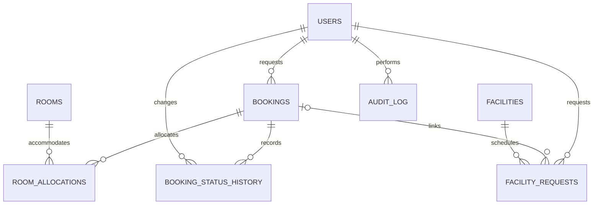

# Implementation blueprint

Status: Stage 1 baseline, 27 October 2026. Based on the supplied master prompt, the available Project Topic Recommendation discussion, and inspection of the source repository's main tree and key frontend files. This document records implementation decisions; it does not claim those features already exist.

## 1. Scope and requirements

The college guest house initially has eight standard rooms (101–108), two special rooms (201–202), one convention hall, and one dining hall. Standard rooms have two beds and permit one additional bed only with administrator approval. Special-room capacities must be configured from verified property information rather than inferred.

USER can authenticate, maintain a profile, search standard accommodation by dates and guest count, request a stay, request facilities, view their own records and administrator remarks, and cancel eligible pending requests. ADMIN can review requests, approve/reject, allocate standard or special rooms, decide extra beds, record bed setup, manage room serviceability, check guests in/out, inspect schedules and history, and manage user activation.

No billing, invoices, payments, meal ordering, or commercial hotel functions.

Public registration is configurable. Initial development supports registration when enabled. Production administrators are provisioned through environment configuration, never through a user-supplied role field. Public pages provide property information; availability and request APIs require authentication.

### Booking rules

- One room per booking in the initial release. Guest count must be 1–3 for a standard-room request. Larger parties receive a clear instruction to submit separate room requests; no silent capacity overflow.
- Stays use property-local dates, Asia/Thimphu. Check-in cannot be in the past and check-out must be later. Intervals are half-open: [arrival, departure), allowing departure and arrival on the same date.
- Updated 28 October 2026: PENDING requests immediately hold a concrete room. PENDING, APPROVED and CHECKED_IN allocations block overlapping dates. Submission, approval and reassignment recheck availability transactionally; see pending-holds-and-live-data.md.
- PostgreSQL exclusion constraints on active room allocations provide a final concurrency safeguard. Approval locks/updates the allocation transactionally; conflicts return HTTP 409.
- Three guests require an extra-bed request and approval before a standard booking can be approved. Rejecting that bed cannot leave an approved three-person booking in a two-person room.
- Store extra-bed requested, decision (PENDING/APPROVED/REJECTED/NOT_REQUESTED), count (0–1), and actual setup. Check-in for three guests requires the approved bed to be recorded as added.
- VIP guest category does not grant permission to allocate special rooms. Only ADMIN can explicitly assign them, subject to configured capacity and availability.
- Room serviceability (ACTIVE/MAINTENANCE/UNAVAILABLE) is distinct from computed date-based availability and current occupancy. The UI derives AVAILABLE/RESERVED/OCCUPIED; a room occupied today may be reserved for a later non-overlapping stay. Initial maintenance blocks future allocations until cleared; scheduled maintenance is a later extension.
- Approve and assign room are atomic for initial approval. Reassignment of an approved booking is also atomic and audited.
- Lifecycle: PENDING → APPROVED or REJECTED or CANCELLED; APPROVED → CHECKED_IN; CHECKED_IN → CHECKED_OUT → COMPLETED. Checkout records both final events in one transaction and releases inventory. CHECKED_OUT remains an audit event rather than a manually maintained waiting state.
- USER cancellation is limited to PENDING. ADMIN cancellation of an APPROVED future booking releases its allocation and records a reason. No cancellation of a checked-in stay.
- Reopen only REJECTED/CANCELLED records with future valid dates, returning them to PENDING only after acquiring a suitable room hold. Completed stays remain immutable; a new stay requires a new booking.
- State changes record actor, time, previous/new state, and remarks. Repeated or invalid transitions return 409.

### Facility rules

Convention requests contain an event date, start/end time, purpose, title, and participant count. End must follow start on the same date. Approved overlapping intervals are forbidden; adjacent intervals are allowed. Pending requests may coexist, but approval rechecks and enforces conflicts transactionally.

Dining requests reserve a date and meal period exclusively in the first release. OTHER requires explicit start/end times; all periods map to configured time windows and are checked for overlap. No food or pricing data is collected. This conservative scheduling policy can be revised once hall capacity and shared-use policy are confirmed.

Facilities may be requested independently or linked to an owned accommodation booking. Each has its own decision and remarks. Accommodation approval does not implicitly approve facilities. Cancelling an accommodation request cancels linked pending facility requests; linked approved requests require an explicit administrator decision and remain visible.

## 2. Target structure

```text
D:\GuestHouse\
  frontend/
    src/
      components/  pages/public/  pages/user/  pages/admin/
      services/  context/  hooks/  types/  utils/  routes/
    public/images/
    package.json
    Dockerfile
  backend/
    src/main/java/bt/edu/cst/guesthouse/
      config/ controller/ dto/ entity/ exception/
      repository/ security/ service/ util/
    src/main/resources/db/migration/
    src/test/
    pom.xml
    mvnw  mvnw.cmd
    Dockerfile
  docs/
  postman/
  screenshots/
  .github/workflows/ci.yml
  .env.example
  .gitignore
  compose.yaml
  compose.production.yaml
  README.md
```

Preserve the original CST-GuestHouse prototype during migration. Reuse suitable original assets; correct filename case and missing image references. Replace hotel-style room categories with verified standard/special accommodation. Convert reusable header, footer, navigation, cards, and forms into React components.

## 3. Database design

Use PostgreSQL and versioned Flyway migrations. UUID primary keys, unique normalized email and booking reference, timestamptz audit fields, and database checks for valid counts/dates. APIs expose DTOs, never password hashes or JPA entities.



Text relationships: one user owns many bookings and facility requests. Each booking has allocation history but at most one active room allocation. One room accommodates many non-overlapping allocations over time. Bookings have many status events. Facility requests belong to one facility and optionally one accommodation booking.

| Table | Main fields |
|---|---|
| users | id, full_name, normalized email, phone, password_hash, role, active, created_at, updated_at |
| rooms | id, unique room_number, name, category, standard_beds, normal_capacity, max_capacity, supports_extra_bed, description, floor, service_status, image_url, timestamps |
| bookings | id, unique reference, user_id, guest contact snapshot, organization, designation, guest_category, purpose, guests, check_in_date, check_out_date, preferred_category, extra_bed_requested, extra_bed_decision, extra_bed_count, extra_bed_added, status, user_remark, admin_remark, actual arrival/departure timestamps, version, timestamps |
| room_allocations | id, booking_id, room_id, arrival, departure, active, assigned_by, assigned_at, released_at |
| booking_status_history | id, booking_id, previous_status, new_status, changed_by, remark, changed_at |
| facilities | id, unique type (CONVENTION/DINING), name, active, optional verified capacity |
| facility_requests | id, facility_id, user_id, nullable booking_id, title, purpose, usage_date, start_time, end_time, nullable meal_period, participants, status, user_remark, admin_remark, version, timestamps |
| audit_log | id, actor_id, action, entity_type, entity_id, description, created_at |

The two hall request types share a scheduling table to enforce overlap rules consistently, while retaining separate DTOs and API endpoints. Seed exactly ten initial rooms and two facilities idempotently. Do not seed invented production guests or production passwords.

## 4. API contract

All routes start with /api. JSON errors have code, message, fieldErrors where applicable, and requestId. Use 400 validation, 401 unauthenticated, 403 forbidden, 404 missing/inaccessible owned resource, and 409 conflicts. List endpoints support bounded pagination; administrative booking lists support date/status/category/search filters.

| Access | Method and path | Purpose |
|---|---|---|
| Public | POST /auth/register | Register when enabled; always USER |
| Public | POST /auth/login | Authenticate; JWT and safe user DTO |
| Authenticated | POST /auth/logout | End/revoke current session |
| Authenticated | GET /auth/me | Current user and role |
| Authenticated | GET, PUT /users/profile | Read/update own permitted profile fields |
| Authenticated | GET /rooms | Room catalogue; restrict special-room allocation details |
| Authenticated | GET /rooms/{id} | Room details |
| Authenticated | GET /rooms/available?checkIn=&checkOut=&guests= | Standard-room options and extra-bed requirements |
| USER/ADMIN | POST /bookings | Submit own request |
| USER/ADMIN | GET /bookings/my | Own bookings |
| Owner/ADMIN | GET /bookings/{id} | Details and timeline |
| Owner/ADMIN | PATCH /bookings/{id}/cancel | Eligible cancellation |
| ADMIN | GET /admin/bookings | Search/filter all bookings |
| ADMIN | GET /admin/bookings/{id} | Full review details |
| ADMIN | PATCH /admin/bookings/{id}/approve | Atomic approval with room and bed decision |
| ADMIN | PATCH /admin/bookings/{id}/reject | Reject with reason |
| ADMIN | PATCH /admin/bookings/{id}/assign-room | Reassign approved allocation |
| ADMIN | PATCH /admin/bookings/{id}/extra-bed | Decide bed request within capacity rules |
| ADMIN | PATCH /admin/bookings/{id}/extra-bed/setup | Record actual bed added/removed |
| ADMIN | PATCH /admin/bookings/{id}/check-in | Record arrival |
| ADMIN | PATCH /admin/bookings/{id}/check-out | Checkout and completion transaction |
| ADMIN | PATCH /admin/bookings/{id}/reopen | Eligible return to pending |
| ADMIN | PATCH /admin/bookings/{id}/remarks | Update remark with audit |
| ADMIN | GET, POST /admin/rooms | List/create rooms; initial inventory remains ten |
| ADMIN | PUT /admin/rooms/{id} | Update room details |
| ADMIN | PATCH /admin/rooms/{id}/status | Change serviceability safely |
| Authenticated | POST /convention-hall/requests | Submit convention request |
| Authenticated | GET /convention-hall/my | Own convention requests |
| Authenticated | POST /dining-hall/requests | Submit dining request |
| Authenticated | GET /dining-hall/my | Own dining requests |
| Owner/ADMIN | GET /facility-requests/{id} | Facility request detail |
| Owner/ADMIN | PATCH /facility-requests/{id}/cancel | Eligible cancellation |
| ADMIN | GET /admin/convention-hall/requests | Convention requests/schedule |
| ADMIN | PATCH /admin/convention-hall/{id}/approve | Approve without overlap |
| ADMIN | PATCH /admin/convention-hall/{id}/reject | Reject with remark |
| ADMIN | GET /admin/dining-hall/requests | Dining requests/schedule |
| ADMIN | PATCH /admin/dining-hall/{id}/approve | Approve without overlap |
| ADMIN | PATCH /admin/dining-hall/{id}/reject | Reject with remark |
| ADMIN | PATCH /admin/facility-requests/{id}/complete | Complete eligible usage |
| ADMIN | GET /admin/dashboard/summary | Counts for selected property-local date |
| ADMIN | GET /admin/current-guests | Checked-in stays |
| ADMIN | GET /admin/arrivals-departures?date= | Arrival/departure lists |
| ADMIN | GET /admin/users | Safe user listing |
| ADMIN | PATCH /admin/users/{id}/active | Activate/deactivate; protect last active admin |
| ADMIN | GET /admin/reports/summary?from=&to= | Basic occupancy/request summaries |

JWTs have bounded expiration. Implement server-side revocation for logout and disabled accounts; do not treat hiding a frontend route as authorization. Keep tokens out of persistent browser localStorage. Use a same-origin deployment and a documented session strategy before implementing authentication; memory-held access tokens require re-login after reload in the initial version. Any cookie-based extension requires CSRF protection. Restrict CORS to configured origins.

## 5. Screens and visual system

Public: Home, Rooms overview, Facilities overview, About, Contact, Login, Register when enabled. No fake password recovery action; add a real recovery flow only if email delivery is configured.

User: Dashboard, Availability search/results, Room details, New booking, Submission confirmation, My bookings, Booking detail/timeline, Facility requests and request forms, Profile.

Admin: Dashboard, Booking list/detail, Room management, Special-room allocation, Extra-bed requests, Convention schedule, Dining schedule, Current guests, Arrivals/departures, Users, Basic reports.

Shared: 404, 403, session expired, network/server errors, loading and empty states, accessible confirmation dialogs.

Design tokens: navy #142D4E, primary blue #2457A7, background #F5F7FB, white surfaces, text #172B4D, muted #52647A. Use semantic green/amber/red/blue/gray badges with text labels and sufficient contrast. Font: Inter with system fallback. Spacing scale: 4/8/12/16/24/32/48px. Cards: 12px radius, restrained shadow, consistent borders. Form controls: at least 44px interaction height, visible labels/focus/errors. Use a constrained public-page width and sidebar dashboards; stack cards/forms on mobile and adapt tables. Respect reduced motion. Validate final color pairings rather than assuming every token combination is accessible.

## 6. Roadmap and acceptance gates

1. Requirements/UI planning/ER/API contract: this document. Review explicit assumptions as implementation progresses.
2. Repository setup: preserve Git history, prototype and assets; use a development branch; inspect repository instructions; verify Java 21, Node, Docker; add Maven wrapper and environment example.
3. Backend foundation and PostgreSQL: migrations, entities, repositories, DTOs, services, controllers, validation, security and roles. Gate: authentication and ownership/role tests pass.
4. Accommodation: room management, availability, booking transitions, extra beds, VIP allocation and check-in/out. Gate: complete API lifecycle plus concurrency and capacity tests pass.
5. Facilities: both request types, approval and conflict safeguards. Gate: overlap, adjacency and ownership tests pass.
6. React migration: shared components, public pages, user pages, admin pages, API integration and responsive/accessibility work. Gate: browser demonstration completes standard, extra-bed and VIP scenarios.
7. Verification: Postman, JUnit/Mockito, PostgreSQL integration tests, practical frontend component tests and browser workflows. Gate: forbidden access, invalid dates, simultaneous approval and facility conflicts are tested.
8. Containers: production frontend/backend images, PostgreSQL volume, health checks, Compose and environment docs. Gate: clean full-stack container startup and persistence verified.
9. CI/CD: frontend/backend tests and builds gate scans and Docker builds; deployment depends on successful required jobs. Configure deployment when a target and credentials are available.
10. Delivery: HTTPS/reverse proxy, production checks, screenshots, architecture/testing/deployment documentation and demonstration. Never claim deployment is complete without verifying the running environment.

Tests are added alongside business logic; the later verification stage consolidates evidence rather than postponing all testing. Each implementation stage documents changed files, PowerShell commands, expected results, checks actually run and remaining limitations. No stage is labelled working when its required checks fail.

## 7. Environment observations

The workspace was empty at initial inspection. Git, Node/npm, Java and Docker executables were found on PATH. Maven was not found. The Java PATH points through an Oracle java8path directory; actual runtime version and Java 21 availability still need checking. Executable presence does not confirm Docker daemon availability. No dependencies have been installed and no application has been run yet.

Operational details to verify before production: actual special-room capacities, college contact information, authorized registration policy, dining time windows/shared-use policy, and hosting target. Development uses documented configurable defaults where appropriate; no unverified contact information is presented as real.
