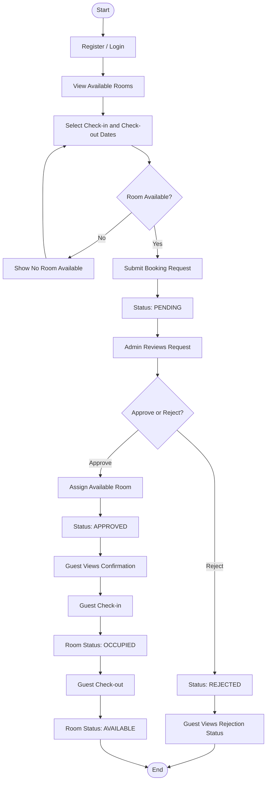

# CST Guest House Management System

A web-based guest house management system designed to simplify room availability checking, booking requests, reservation approval, room allocation, and guest check-in and check-out.

## About the Project

The **CST Guest House Management System** aims to provide a convenient platform for guests to view available rooms and submit booking requests online. Administrators can manage room information, review booking requests, approve or reject reservations, assign rooms, and track guest check-in and check-out.

The project also uses a CI/CD pipeline with GitHub Actions to automate application builds and tests before deployment.

## Features

### Guest Features
- User registration and login.
- View available rooms and room details.
- Select check-in and check-out dates.
- Check room availability.
- Submit booking requests.
- View booking status and confirmation.

### Administrator Features
- Access the administrative dashboard.
- Manage room information and availability.
- View and review booking requests.
- Approve or reject booking requests.
- Assign rooms to approved bookings.
- Record guest check-in and check-out.
- Update room occupancy status.

### CI/CD Features
- Automated workflow using GitHub Actions.
- Frontend build and test execution.
- Backend build and test execution.
- Stop the pipeline if required builds or tests fail.
- Build Docker images after successful checks.
- Deploy the application to the configured environment.

## Booking Workflow



### Booking Statuses

| Status | Description |
|---|---|
| `PENDING` | The booking request awaits administrator review. |
| `APPROVED` | The booking has been approved and a room assigned. |
| `REJECTED` | The booking request has been rejected. |

### Room Statuses

| Status | Description |
|---|---|
| `AVAILABLE` | The room is available for assignment, subject to the requested dates. |
| `OCCUPIED` | A guest is currently staying in the room. |

## CI/CD Pipeline

The project uses GitHub Actions to automate the build, test, and deployment process.

```text
Developer writes code
        |
        v
Git Commit
        |
        v
Push to GitHub
        |
        v
GitHub Actions Workflow
        |
        v
Build Frontend
        |
        v
Run Frontend Tests
        |
        v
Build Backend
        |
        v
Run Backend Tests
        |
        v
All Checks Pass?
     /       \
   No         Yes
   |           |
   v           v
  Stop     Build Docker Images
                |
                v
             Deployment
```

**Pipeline rule:** If a required build or test fails, the workflow must stop before the Docker image build and deployment stages.

## Technologies Used

Update this section to match the actual technologies used in the project.

- **Frontend:** Add your frontend framework or library.
- **Backend:** Add your backend framework or language.
- **Database:** Add your database technology.
- **Version Control:** Git and GitHub.
- **CI/CD:** GitHub Actions.
- **Containerization:** Docker.
- **Deployment:** Add your hosting platform or deployment environment.

## Getting Started

### Prerequisites

Install the tools required by your project:

- Git
- The appropriate frontend runtime and package manager
- The appropriate backend runtime
- The database used by the application
- Docker, if required for local development or deployment

### Installation

**1. Clone the repository**

```bash
git clone https://github.com/Boogey05/cst-guest-house.git
```

**2. Navigate to the project directory**

```bash
cd cst-guest-house
```

**3. Install dependencies**

Install the frontend and backend dependencies according to their respective package managers and project configuration.

**4. Configure environment variables**

Create the required environment configuration files and set the database connection, application settings, and other required credentials. Do not commit passwords, API keys, or other secrets to GitHub.

**5. Start the application**

Follow the frontend and backend startup instructions for the frameworks used in this repository.

> **Note:** The exact installation and startup commands depend on your project's framework and directory structure. Add the verified commands once the implementation is finalized.

## Project Structure

The following is an example structure. Adjust it to match your actual repository.

```text
cst-guest-house/
├── frontend/               # Frontend application
├── backend/                # Backend application
├── .github/
│   └── workflows/          # GitHub Actions workflows
├── docker-compose.yml       # Optional Docker configuration
├── .gitignore
└── README.md
```

## User Roles

| Role | Responsibilities |
|---|---|
| Guest | Register, log in, view rooms, check availability, and submit booking requests. |
| Administrator | Manage rooms, review bookings, assign rooms, and record check-in and check-out. |
| Developer | Develop features, maintain code, run tests, and manage the CI/CD workflow. |

## Development Workflow

1. Clone the repository.
2. Create a branch for your feature or bug fix.
3. Implement and test your changes locally.
4. Commit the changes with a descriptive commit message.
5. Push the branch to GitHub.
6. Review the results of the GitHub Actions workflow.
7. Merge approved changes according to the team's workflow.

## Documentation

For more details about the application workflow and CI/CD process, visit the [CST Guest House Wiki](../../wiki).

## Project Goals

- Simplify the guest house booking process.
- Improve room availability tracking.
- Reduce manual booking administration.
- Provide clear booking statuses for guests and administrators.
- Improve software quality through automated testing.
- Support consistent builds and reliable deployments.

## Contributors

1. Sherab Dorji
2. Kinley Phuntsho(Leader)
3. Chimi Gyeltshen
4. Karma Sonam ( )
5. Pasang Gyeltshen
6. Sonam Choejur (Frontend/ Backend/ DB)


## License

Add the license selected for this project, if applicable.

---

**CST Guest House Management System** — simplifying guest house reservations and administration.
